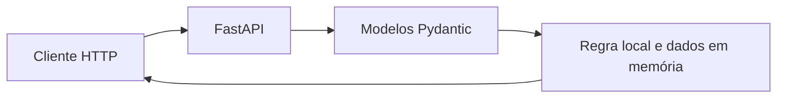

 | [](LICENSE) | [](https://github.com/sponsors/felipetjmg1-bit)

# Aurora Kids Alfa — API de Regra de Acesso

## Visão geral

O conteúdo efetivamente implementado é um protótipo Python/FastAPI de uma API que decide permitir ou negar acesso segundo a idade calculada de um perfil de demonstração e a hora local atual (00:00–06:00). A API usa um usuário em memória; não há implementação no código publicado de verificação de CPF externa, bloqueio de dispositivos/apps, restrição nativa Android/iOS, integração com plataformas ou painel parental, apesar de essas ideias aparecerem no README e no diagrama conceptual.

## Objetivo e valor

**Problema/escopo:** Protótipo de API FastAPI que aplica uma regra de toque de recolher digital a perfis de demonstração.

**Valor verificável hoje:** o repositório torna explícitos seus artefatos, interfaces e limitações para que mantenedores e contribuidores possam avaliar o que existe sem confundir demonstração, proposta e produção.

## Arquitetura e tecnologias

Código efetivo pequeno: src/main.py inicia Uvicorn; src/api.py define a app FastAPI, rotas e regra; src/models.py define esquemas Pydantic. Há um dicionário users_db hard-coded, sem banco persistente. O architecture.mmd documenta um fluxo conceptual com banco centralizado, painel parental e modo de SO, elementos não implementados nos módulos publicados; portanto, a arquitetura conceitual está documentada, mas não corresponde à arquitetura executável além do protótipo de API.



- Python (linguagem identificada pelo GitHub; arquivos em src/).
- FastAPI e Uvicorn; o entrypoint executa uvicorn.run para api:app em 0.0.0.0:8000.
- Pydantic para os modelos UserProfile, AccessRequest e AccessResponse.
- requirements.txt lista fastapi, uvicorn, pydantic, pytest e httpx; versões não estão fixadas.
- architecture.mmd é um diagrama Mermaid; GitHub contabiliza Python e Mermaid.

## Início rápido

Os comandos abaixo refletem instruções, manifestos ou pontos de entrada presentes no repositório. Dependências externas, segredos e serviços estão indicados quando aplicável; a presença de um comando não equivale a uma execução validada.

1. Clone com a URL real do repositório: git clone https://github.com/felipetjmg1-bit/aurora-kids-alfa.git
2. Entre no diretório: cd aurora-kids-alfa
3. Instale as dependências listadas: pip install -r requirements.txt
4. Inicie usando o entrypoint existente: python src/main.py (o código configura Uvicorn na porta 8000).
5.


## Exemplo de uso

A API expõe `POST /validate-access` (campos `user_id` e `app_id`) e `GET /health`. Exemplo com o perfil local de demonstração:

```bash
curl -X POST http://127.0.0.1:8000/validate-access \
  -H 'Content-Type: application/json' \
  -d '{"user_id":"user123","app_id":"demo"}'
```

A decisão usa a idade calculada e o relógio local do servidor. Não há verificação externa de identidade; consulte as limitações antes de usar com dados reais.

## Estado e limitações

**Maturidade indicada:** Demonstração.

- Não descrever o protótipo como mecanismo real de proteção, bloqueio de rede ou restrição de sistema operacional: o código publicado só responde a uma decisão de API e mantém os dados em memória.
- O CPF e nome no registro de exemplo têm formato de dados pessoais; não reutilizar como credencial nem tratá-los como prova de validação. Não há autenticação/autorização visível nas rotas.
- A regra consulta datetime.now() local; não usa o timestamp enviado na solicitação nem documenta fuso horário. O campo is_minor do modelo não é usado na decisão; a idade é calculada de birth_date.
- README diz protótipo e recomenda Python 3.10+, mas execução, compatibilidade e testes não foram confirmados na revisão estática do repositório; arquivo de teste está vazio.

## Contribuição

Leia [CONTRIBUTING.md](CONTRIBUTING.md) antes de abrir uma issue ou pull request. Para reportes de segurança, siga a orientação específica do repositório, se houver.

## Licença

Este repositório está licenciado sob **MIT**; consulte [LICENSE](LICENSE).

## Patrocínio e apoio

O desenvolvimento aberto exige tempo para manutenção, documentação, testes, revisão de contribuições e resposta a issues. Se este projeto for útil, considere apoiar a continuidade pelo [GitHub Sponsors](https://github.com/sponsors/felipetjmg1-bit). O apoio não representa promessa de funcionalidades, prazo de entrega ou suporte comercial.

[](https://github.com/sponsors/felipetjmg1-bit)
